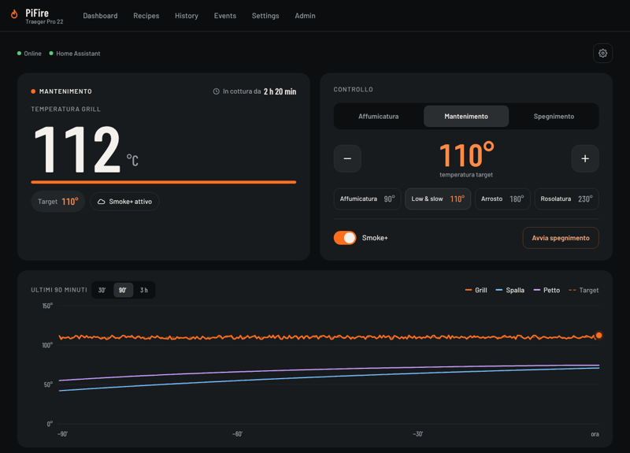
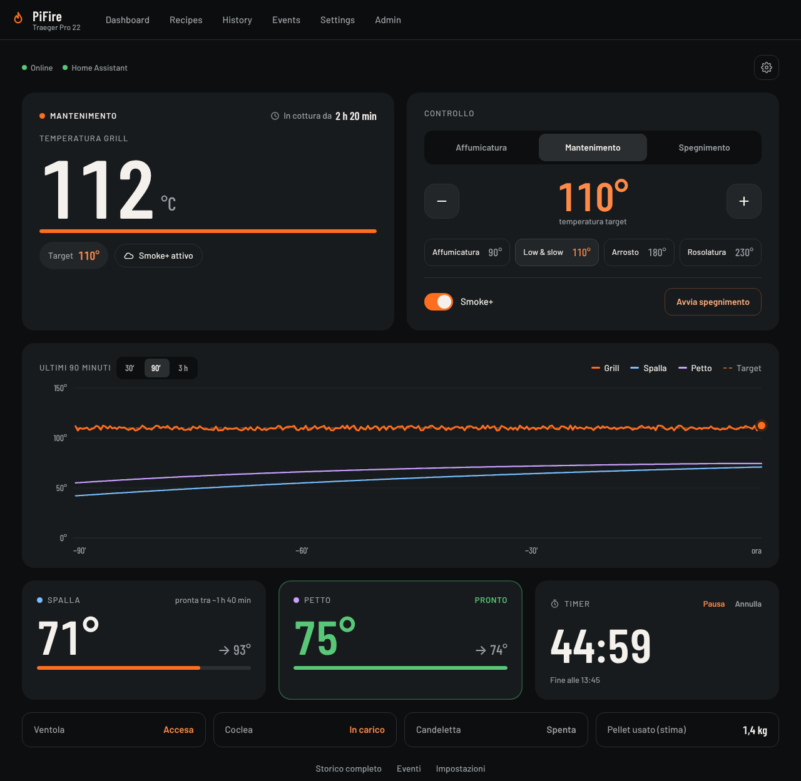
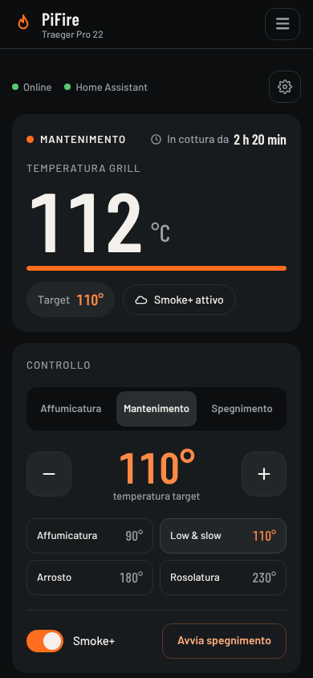
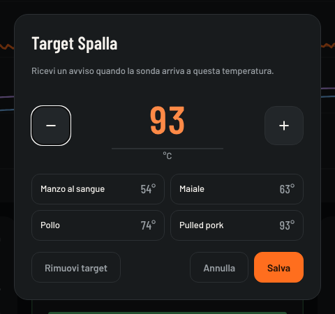
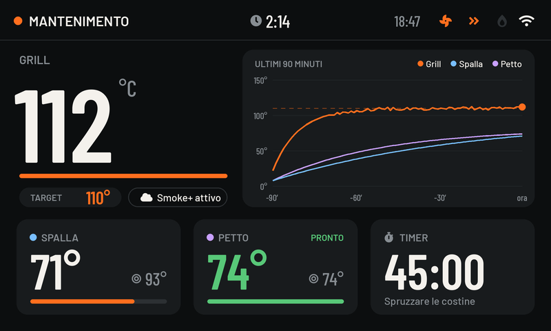
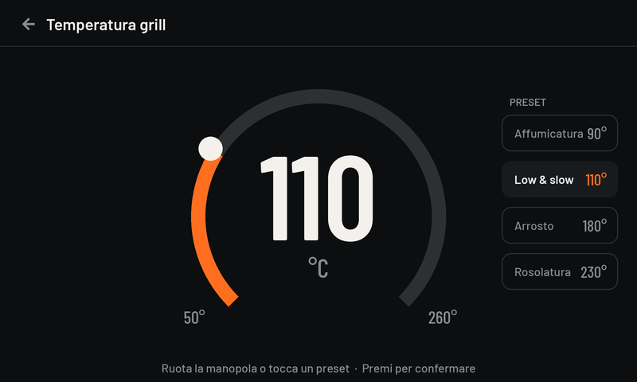

# PiFire per Orange Pi Zero 2W

Controller smart per barbecue a pellet, derivato da [PiFire](https://github.com/nebhead/PiFire) di Ben Parmeter e portato su **Orange Pi Zero 2W** al posto del Raspberry Pi.

È pensato per un **Traeger Pro 22** di vecchia generazione: ventola AC, coclea e candeletta a **230 V**, controller originale sostituito dalla PCB v4.x.x di PiFire con il modulo relè SSR e la scheda ADS1115 per le sonde. Si usa dal telefono, da Home Assistant e, più avanti, da un display touch da 5″ montato sul grill.



> [!WARNING]
> Il controller comanda carichi a 230 V e un fuoco vero. Fai i test dei relè solo con il lato 230 V scollegato, non lasciare il grill acceso senza nessuno nei paraggi finché il sistema non è collaudato, e tieni a portata di mano l'interruttore generale.

## Cosa cambia rispetto a PiFire

| Area | Novità |
|---|---|
| **Scheda** | Modulo di piattaforma `grillplat/orangepi_zero2w.py`: GPIO con libgpiod, PWM hardware via sysfs, temperatura CPU e Wi-Fi senza gli strumenti del Raspberry. Le impostazioni restano in numeri GPIO Raspberry e vengono tradotte sul pin dell'Orange Pi nella stessa posizione dell'header. |
| **Installazione** | Script di preparazione per Armbian (Debian 13 trixie), verifica di pin, I2C, SPI e relè, installer che scarica da questo repository privato con una deploy key in sola lettura. |
| **Controllo** | I PID ora lavorano correttamente in °C (prima i parametri, pensati in °F, davano un controllo diverso). Tolto il "colpo" derivativo del primo ciclo. |
| **Fiamma spenta** | Rilevatore di fiamma spenta in Mantenimento: riduce il pellet appena sospetta lo spegnimento e avvia la riaccensione prima che il braciere si riempia di pellet crudo. Distingue il coperchio aperto. |
| **Home Assistant** | Comandi via MQTT (modalità, temperatura, Smoke+) con regole di sicurezza; l'accensione da remoto è disattivata di default. |
| **Web app** | Dashboard *Moderna* e tema scuro *Ember* per tutte le pagine, utilizzabili anche senza internet. |
| **Wi-Fi** | Rete di emergenza aperta *PiFire-Setup* quando il grill non trova il Wi-Fi: ti colleghi col telefono e scegli la rete nuova. Pagina Wi-Fi per aggiungere reti prima di cambiare la password del router. |
| **Correzioni** | In °C il target di una sonda finiva sulla temperatura del grill; due comandi ravvicinati si annullavano a vicenda; ricerca WLED e caricamento delle cotture non funzionavano. |
| **Sicurezza web** | Chiuse falle della web app originale (comandi di shell e percorsi di file presi dalle richieste), web app raggiungibile solo tramite nginx, librerie aggiornate, controllo settimanale delle vulnerabilità e Dependabot. |
| **Sviluppo** | Simulatore del grill per provare i controller, test automatici su GitHub, promozione manuale della versione stabile. |

Tutte le funzioni di PiFire restano: ricette, storico delle cotture, notifiche, Smart Start, gestione del pellet, aggiornamenti dalla web app.

## Screenshot

Dashboard Moderna su PC e su telefono, durante una cottura in Mantenimento a 110 °C con due sonde (dati simulati):

<table>
  <tr>
    <td width="68%"></td>
    <td width="32%"></td>
  </tr>
</table>

Toccando la scheda di una sonda si imposta il target, con i valori tipici a portata di dito. Quando la sonda ci arriva, la scheda diventa verde con *PRONTO*.




- [x] Porting del software e installer per Orange Pi
- [x] Correzioni al controllo, rilevatore di fiamma spenta, comandi da Home Assistant
- [x] Web app: dashboard Moderna e tema Ember
- [x] Rete Wi-Fi di emergenza e pagina Wi-Fi
- [ ] Prima accensione sulla scheda vera e verifica dei pin
- [ ] Ordine PCB su JLCPCB e montaggio
- [ ] Interfaccia per il display HDMI 5″ 1024×600 con encoder
- [ ] Web app in italiano e installabile sul telefono
- [ ] Case stampati in 3D
- [ ] Taratura del simulatore sulle prime cotture vere

Piano di lavoro e lista della spesa: [PiFire Orange Pi](https://claude.ai/artifact/RDBWNfmtbJo1nxR27YnyJm).

## Hardware

| Componente | Scelta |
|---|---|
| Scheda | Orange Pi Zero 2W 1 GB (Allwinner H618), con dissipatore |
| Archiviazione | microSD |
| Scheda principale | PCB PiFire v4.x.x (relè attivi alti) |
| Relè | modulo SSR di PiFire per i carichi AC |
| Sonde | ADS1115 su I2C1 (indirizzo `0x48`) per la sonda del grill e le sonde cibo |
| Display (in arrivo) | HDMI 5″ IPS 1024×600 capacitivo (MPI5006) + encoder KY-040 |
| Ventola | AC originale. Upgrade a ventola DC PWM previsto come opzione futura |

Bozze della schermata del display da 5″, con lo stesso stile della web app (temperatura e grafico a sinistra, sonde e timer sotto; la temperatura si cambia con la manopola o con i preset):

<table>
  <tr>
    <td></td>
    <td></td>
  </tr>
</table>

*Sono bozze a 800×480: la schermata vera sarà a 1024×600, la risoluzione del display scelto.*

Mappa dei pin, collegamenti e precauzioni (console seriale sui pin 8 e 10, pin 33 senza PWM hardware) sono in [ORANGEPI.md](ORANGEPI.md#mappa-dei-pin-pcb-v4--orange-pi-zero-2w).

## Installazione

La guida passo passo è in **[ORANGEPI.md](ORANGEPI.md)**. In breve:

1. Armbian **Debian 13 trixie Minimal** sulla microSD, Wi-Fi configurato, kernel bloccato con `armbian-config`.
2. Chiave SSH di root sull'Orange Pi, aggiunta come **deploy key in sola lettura** di questo repository.
3. Clone e preparazione:
   ```bash
   sudo GIT_SSH_COMMAND="ssh -o StrictHostKeyChecking=accept-new" \
     git clone -b orangepi-dev git@github.com:cannos88/pifire-orangepi.git /opt/pifire-setup
   sudo bash /opt/pifire-setup/auto-install/orangepi/setup.sh
   ```
4. Verifica: `sudo python3 /opt/pifire-setup/auto-install/orangepi/opi_check.py`
5. Wizard su `http://<indirizzo-orange-pi>`: piattaforma *PiFire PCB 4.x.x Modular PCB + Orange Pi Zero 2W*, relè *Active High*, ventola *AC*, unità °C.

## Uso

**Web app.** Dal telefono o dal PC apri l'indirizzo dell'Orange Pi. La dashboard Moderna mostra temperatura, modalità e tempo di cottura, permette di accendere, passare tra Affumicatura e Mantenimento, cambiare la temperatura (con preset), attivare Smoke+, impostare i target delle sonde e un timer. Accensione, spegnimento e Stop chiedono conferma. Le pagine classiche di PiFire (Storico, Ricette, Eventi, Impostazioni, Admin) restano disponibili con lo stesso tema.

**Home Assistant.** In *Settings → Notifications → MQTT* abilita MQTT con l'autodiscovery e, se vuoi comandare il grill, *Allow remote control*. Compaiono le entità Grill Mode, Hold Temperature e Smoke Plus. Le regole di sicurezza sono descritte in [ORANGEPI.md](ORANGEPI.md#home-assistant).

**Wi-Fi.** Se cambi la password del router il grill non resta irraggiungibile: dopo 3 minuti senza rete accende la rete aperta **PiFire-Setup**. Ti colleghi col telefono, si apre la pagina Wi-Fi del grill (oppure `http://10.42.0.1`) e scegli la rete con la password nuova. Da quella rete si vede solo la pagina Wi-Fi, non i comandi del grill. Dettagli in [ORANGEPI.md](ORANGEPI.md#wi-fi-e-rete-di-emergenza).

**Aggiornamenti.** Non serve togliere la scheda: da *Admin → System Updates* PiFire scarica l'ultima versione dal ramo scelto di questo repository, con le librerie e i passi di sistema elencati nel manifest dell'updater. Il grill usa `orangepi-stable`, che si aggiorna solo con una promozione manuale dopo i test. Dettagli in [ORANGEPI.md](ORANGEPI.md#aggiornamenti-ota).

## Rami e rilasci

| Ramo | Contenuto |
|---|---|
| `orangepi-dev` | Sviluppo del porting (ramo predefinito) |
| `orangepi-stable` | Versione installata sul grill, aggiornata solo dal workflow *Promote to stable* |
| `main` | Copia di PiFire originale, per importare i loro aggiornamenti |

GitHub Actions:
- **[Orange Pi tests](https://github.com/cannos88/pifire-orangepi/actions/workflows/orangepi-tests.yml)**: a ogni push su `orangepi-dev` e `orangepi-stable`, test su Python 3.11 e 3.13, controllo degli script e confronto dei controller sul simulatore (report scaricabile dalla pagina del run).
- Lo stesso workflow controlla ogni lunedì le librerie del grill con `pip-audit`; Dependabot propone gli aggiornamenti con una pull request.
- **Promote to stable**: si avvia a mano dalla scheda *Actions*; ripete i test e, se passano, porta `orangepi-stable` allo stato di `orangepi-dev` con un tag `stable-AAAAMMGG-HHMM`.

Per importare gli aggiornamenti di PiFire originale:
```bash
git fetch upstream
git checkout main && git merge --ff-only upstream/main
git checkout orangepi-dev && git merge main
```

## Sviluppo

Test (non serve hardware: GPIO e Redis sono simulati):
```bash
pip install -r tests/requirements.txt
python -m pytest tests -q
```

Simulatore del grill, per confrontare i controller e provare scenari come coperchio aperto o fiamma spenta:
```bash
python -m tools.grill_sim --compare pid pid_ac pid_sp pid_clamping --plot confronto.png
python -m tools.grill_sim --scenario flameout --no-flameout-detect
```

Web app in locale, con la piattaforma *prototype* che finge sonde e relè: servono `redis-server` e i pacchetti dell'installer, poi `python control.py` in un terminale e `gunicorn -k eventlet -b 127.0.0.1:8000 -w 1 app:app` in un altro.

Struttura delle parti nuove:

| Percorso | Contenuto |
|---|---|
| `grillplat/orangepi_zero2w.py`, `grillplat/opi_gpio.py` | Piattaforma Orange Pi e traduzione dei pin |
| `auto-install/orangepi/` | Preparazione del sistema (`setup.sh`) e verifica (`opi_check.py`) |
| `controller/flameout.py` | Rilevatore di fiamma spenta |
| `notify/mqtt_control.py` | Comandi da Home Assistant e regole di sicurezza |
| `wifi/`, `blueprints/wifi/` | Servizio Wi-Fi (rete di emergenza) e pagina Wi-Fi |
| `dashboard/modern.json`, `blueprints/dash/*/modern/` | Dashboard Moderna |
| `static/css/ember.css`, `static/font/barlow/` | Tema Ember e font |
| `tools/grill_sim/` | Simulatore del grill |
| `tests/` | Test automatici |
| `docs-orangepi/` | Bozze grafiche del display |

## Documentazione

- [ORANGEPI.md](ORANGEPI.md): guida completa del porting (installazione, pin, note hardware, fiamma spenta, Home Assistant, simulatore).
- [Documentazione di PiFire](http://docs.pifire.io): funzioni generali, hardware originale, impostazioni, ricette, API.
- [Repository originale nebhead/PiFire](https://github.com/nebhead/PiFire) e il suo [Discord](https://discord.gg/F9mbCrbrZS).
- [Armbian per Orange Pi Zero 2W](https://www.armbian.com/orangepizero2w/).
- Mockup della web app: [PiFire Web App](https://claude.ai/artifact/Jf3y8ExsQ29xC1qzHDu1rX).

## Crediti

**PiFire** è di Ben Parmeter e dei suoi contributori ([github.com/nebhead](https://github.com/nebhead/PiFire)); questo repository ne è una derivazione personale. Il controller PID viene da **PiSmoker** di Dan Borello ([github](https://github.com/DBorello/PiSmoker)).

Componenti di terze parti inclusi o usati da PiFire:
- **Bootstrap 4** (MIT, Twitter), **jQuery** (MIT, JS Foundation), **Popper** (MIT, Federico Zivolo)
- **Chart.js** (MIT, Chart.js Contributors)
- **Font Awesome Free** (Font Awesome Free License)
- **Circliful** (MIT, Patric Gutersohn), **SVG Gauge** (MIT, Aniket Naik), **Bootstrap Color Picker** (MIT, Javi Aguilar)
- **Luma OLED** (MIT, Richard Hull) e **ADS1115** (David H Hagan), non distribuiti ma usati dai moduli
- **Barlow** e **Barlow Condensed** di Jeremy Tribby, SIL Open Font License 1.1 ([testo della licenza](static/font/barlow/OFL.txt))

## Licenza

MIT, come PiFire. Il testo completo è in [license.txt](license.txt).

```
Copyright (c) 2020-2025 Ben Parmeter and Contributors
Modifiche per Orange Pi Zero 2W: Copyright (c) 2026 Carmelo (cannos88)
```
